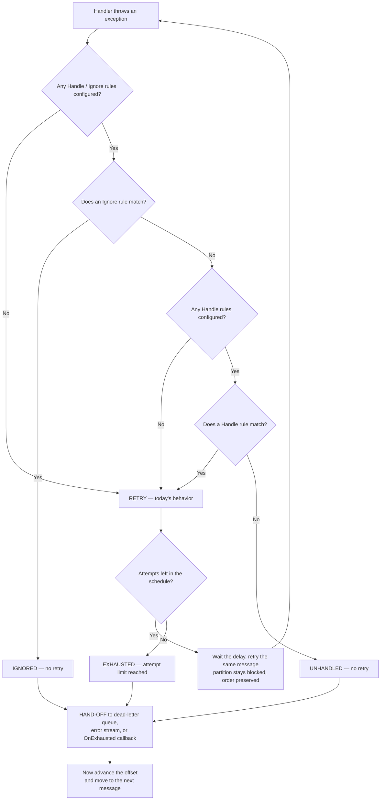

# Handle / Ignore exception filtering for retry decisions

Date: 2026-11-17
Status: proposed — awaiting approval

## Intent and why

StreamBus currently retries every handler exception through the same schedule. The
docs already promise the fix: `Handle<TException>` / `Ignore<TException>` on the
retry configurator, so a schedule can retry transient exceptions and immediately
hand off poison ones (`concepts/exceptions.mdx:31-33`,
`guides/handle-failures.mdx:195-204`).

The intended semantics are the established ones for a `Handle` / `Ignore`
exception-filter model:

- `Handle` / `Ignore` are **exception filters on the retry policy**; they are the
  mechanism that decides whether an exception is "handled" and therefore retried.
  Unhandled exceptions fault immediately (in StreamBus: exhaust + hand-off).
- With **no filters**, all exceptions are retried (today's StreamBus behavior).
- `Handle` is an **include** rule; `Ignore` is an **exclude** rule. When both
  match, **Ignore wins**. Combining them is supported with this defined
  precedence, and the docs must state it explicitly.
- Matching uses `Type.IsInstanceOfType` (so derived exceptions match), checks the
  thrown exception, its `GetBaseException()`, and — for `AggregateException` —
  the direct inner exceptions and their base exceptions. Predicate overloads
  filter further (e.g. `Ignore<ArgumentException>(e => e.ParamName == "x")`).
- Retry can be configured at multiple scopes; each retry policy carries its own
  filter configuration.

## Goals

- Add the established `Handle` / `Ignore` API to the retry configurator.
- Make the filter result the first input to the single retry/exhaust decision in
  `StreamPartitionConsumer.DispatchAsync`.
- Leave the retry schedule, exhaustion, hand-off, and offset-advance machinery
  otherwise unchanged.
- Keep `UseRetry` as the single configuration verb: fluent and raw-policy
  overloads at both bus and endpoint scope stay exactly as they are.
- Replace the "Planned" notes in the docs with the real behavior and reference.
- **Enable Mermaid rendering in the docs site and include the flow diagram and
  the Exponential example below verbatim** — this is a required deliverable, not
  optional polish.
- Cover matching, precedence, configuration, validation, and runtime behavior
  with unit and integration tests.

## Non-goals

- No changes to the deserialization-failure path (already immediate hand-off /
  attach recycle — deterministic, never burns the retry budget).
- No changes to `OnExhausted` callback failures (recycle the attach, never skip),
  attach/startup retry loops, publish pipeline, or transport-level retries.
- No scheduled/second-level redelivery, no new dead-letter destinations, no new
  error-envelope fields.
- No attribute/decorator-based handler configuration.

## Anti-goals

- Advancing the offset without a hand-off (silently skipping a message).
- Letting an ignored or unhandled exception retry anyway because no hand-off was
  configured — that would make the feature a no-op exactly where it matters.
- Weakening the existing invariant "unbounded schedule ⇒ no hand-off configured".
- Changing endpoint-replaces-global policy semantics.

## Constraints

- .NET 10, nullable enabled, warnings-as-errors, central package management, no
  new dependencies **in the shipped library**.
- **Naming:** no third-party library may be named in code comments, docs, tests,
  specs, or plans. Describe behavior generically ("the standard `Handle`/`Ignore`
  model", "established exception-filter semantics") instead of attributing it.
- Public API additions must be source-compatible; existing overloads unchanged.
- Filters are configured through the configurator callback. The raw `RetryPolicy`
  path keeps "retry all" behavior.
- The docs site uses Starlight 0.42 / Astro 7, which has **no built-in `mermaid`
  config option**. Rendering requires adding the `astro-mermaid` integration
  (plus `mermaid`) and registering it **before** `starlight()` in
  `docs/astro.config.mjs`, per Starlight's own plugin list. A plain fenced
  `mermaid` block would otherwise render as raw text; this integration is the
  chosen way to make the required diagram visible.

## Approaches

**A — Filters stored on the retry policy (chosen).** Add an `IExceptionConfigurator`
surface inherited by `IRetryConfigurator`; accumulate the rules into the
`RetryPolicy` produced by `BuildPolicy()`; add one internal matcher consulted at
the existing `exhausted` decision. One decision point, no new middleware, matches
the documented API. Trade-off: `RetryPolicy` carries an internal filter set, and
an endpoint's `UseRetry` replaces the global filters along with the schedule.

**B — Standalone exception-filter middleware.** A new `UseExceptionFilter(...)`
layer decoupled from retry. More reusable in theory, but two mechanisms with
ordering to reconcile, and it contradicts the API the docs already promise.

**C — Attributes on consumer types.** Declarative, but no attribute precedent in
the project, cannot express predicates cleanly, and fights the fluent
configuration style.

## Decided design

### Public API

Introduce `IExceptionConfigurator` and have the retry configurator inherit it
(the docs' phrase "on the retry configurator" remains true):

```csharp
public interface IExceptionConfigurator
{
    void Handle(params Type[] exceptionTypes);
    void Handle<T>() where T : Exception;
    void Handle<T1, T2>() where T1 : Exception where T2 : Exception;
    void Handle<T1, T2, T3>() where T1 : Exception where T2 : Exception where T3 : Exception;
    void Handle(Func<Exception, bool> filter);
    void Handle<T>(Func<T, bool> filter) where T : Exception;

    void Ignore(params Type[] exceptionTypes);
    void Ignore<T>() where T : Exception;
    void Ignore<T1, T2>() where T1 : Exception where T2 : Exception;
    void Ignore<T1, T2, T3>() where T1 : Exception where T2 : Exception where T3 : Exception;
    void Ignore(Func<Exception, bool> filter);
    void Ignore<T>(Func<T, bool> filter) where T : Exception;
}

public interface IRetryConfigurator : IExceptionConfigurator
{
    // existing: Immediate, Interval, Intervals, Exponential, None, BuildPolicy
}
```

Both predicate forms are provided for both verbs. Including the non-generic
`Ignore(Func<Exception, bool>)` is a deliberate symmetry choice and is documented
as such rather than attributed to an external source.

### Where the rules live

- `RetryConfigurator` keeps `_includes` and `_excludes` accumulators separate
  from `_pending`, so call order relative to the schedule method is irrelevant
  and filters survive the schedule's last-call-wins overwrites.
- `RetryPolicy` gains an internal init-only `ExceptionFilterSet? Filters`
  (null = no rules = retry everything). `BuildPolicy()` returns the scheduled
  policy with the accumulated set attached.
- The raw `UseRetry(RetryPolicy)` path cannot set filters; it behaves as "no
  rules", matching the configurator-only model.

### Matching (established exception-filter semantics)

A single internal `ExceptionFilterSet` builds the candidate sequence:

1. the thrown exception,
2. `ex.GetBaseException()`,
3. when that base is `AggregateException`, each direct inner exception and each
   inner exception's `GetBaseException()`.

- A **type rule** matches when any candidate `IsInstanceOfType` against any of
  its configured types.
- A **predicate rule** matches when any candidate is assignable to `T` and the
  predicate returns true.
- `Decide(ex)` returns an internal `RetryDecision`: `Ignored` if an Ignore rule
  matches; else `Unhandled` if any Handle rules exist but none match; else
  `Retry` (including the empty-set case, which retries everything). Only `Retry`
  permits another attempt. Returning the reason lets the runtime log
  "ignored" vs. "unhandled" rather than a generic "not handled".

### Runtime decision

In `StreamPartitionConsumer.DispatchAsync`, replace the single `exhausted`
computation with:

```
decision  = _options.Retry.Decide(ex)
exhausted = decision != Retry || (!unbounded && attempts >= MaxAttempts)
```

- `decision != Retry`: exhaust on the current attempt (normally 1) via the normal
  `ExhaustAsync` path; log the decision reason instead of "retrying".
- `decision == Retry`: existing schedule and delay logic, unchanged.
- Defensive fallback: if a non-Retry decision is reached with **no hand-off
  configured** (an unreachable state for public callers after validation), mirror
  the deserialization path — log a warning and `FailAttach` to redeliver. Never
  call `ExhaustAsync` with a null destination and never advance the offset.
- Shutdown cancellation, foreign-token cancellation, deserialization failures,
  and `OnExhausted` failures keep their current paths.

### Validation

- `RetryDerivation.Derive` (configurator path): if the effective policy contains
  any Handle or Ignore rules and `MaxAttempts` is null, throw
  `StreamBusConfigurationException` requiring a bounded schedule.
- `ConsumerRegistry.ConsumeCoreAsync` (the single choke point for both raw and
  DI-derived options): enforce the same invariant so internal/raw policies
  cannot reach the runtime unbounded with filters.
- Rationale: StreamBus forbids a hand-off on an unbounded schedule, so an
  ignored/unhandled exception would otherwise have nowhere to go. The derived
  `{stream}_error` queue exists as soon as the schedule is bounded, giving the
  same "failure always lands somewhere inspectable" guarantee.

### Configurator argument validation

Follow the existing configurator convention (`Intervals`, `Exponential`):
throw `ArgumentNullException` for a null `params Type[]` or null predicate,
`StreamBusConfigurationException` for an empty type array, a null element, or a
type not deriving from `Exception`. The multi-generic overloads delegate to the
`params Type[]` path so validation stays in one place.

### Scope inheritance

An endpoint's `UseRetry` produces a complete policy that replaces the bus-wide
one — schedule **and** filters. No merging across scopes; consistent with the
current "one policy, last wins" model, where each retry filter owns its own
configuration.

### Files

- `src/StreamBus/Configuration/RetryConfiguration.cs` — new
  `IExceptionConfigurator`, extend `IRetryConfigurator` and `RetryConfigurator`,
  attach rules in `BuildPolicy()`, validation in `RetryDerivation.Derive`.
- `src/StreamBus/RetryPolicy.cs` — internal `ExceptionFilterSet` / rule types and
  `Decide` matcher; `RetryPolicy.Filters`.
- `src/StreamBus/StreamPartitionConsumer.cs` — use `Decide` in the retry loop,
  log the decision reason, and guard the no-hand-off fallback.
- `src/StreamBus/ConsumerRegistry.cs` — enforce the bounded-schedule invariant
  in `ConsumeCoreAsync`.
- `docs/package.json` + `docs/astro.config.mjs` — add `astro-mermaid` / `mermaid`
  and register `mermaid()` before `starlight()` so the diagram renders.
- `docs/src/content/docs/concepts/exceptions.mdx` — replace the Planned note with
  **the diagram and example below**.
- `docs/src/content/docs/guides/handle-failures.mdx` — replace the roadmap note,
  link to the diagram and show the example.
- `docs/src/content/docs/configuration/retry-and-dead-letters.mdx` — API table,
  matching/precedence rules, bounded-schedule constraint.

### Documentation content (required, verbatim)

The diagram goes on `concepts/exceptions.mdx` (the "what happens when a handler
throws" page), with the example immediately below it:



```csharp
e.UseRetry(r =>
{
    r.Handle<SqlException>();                  // retry these
    r.Ignore<ValidationException>();           // never retry these
    r.Ignore<ArgumentException>(x => x.ParamName == "orderTotal");
    r.Exponential(5, TimeSpan.FromSeconds(5), TimeSpan.FromMinutes(5));
});
```

`Exponential(5, min: 5s, max: 5min)` means 6 total attempts (first delivery plus
five retries), with waits of **5s, 10s, 20s, 40s, 80s** before each retry — the
delay grows every time, capped at 5 minutes. Docs prose must spell out the four
outcomes: `SqlException` retries; `ValidationException` and the param-specific
`ArgumentException` hand off on the first failure; any other exception is
unhandled (a `Handle` rule exists) and also hands off immediately.

### Tests

- New/re extended unit tests in `tests/StreamBus.UnitTests`: derived-type match,
  base/aggregate chain, typed and untyped predicates, include-only, exclude-only,
  both with Ignore winning, empty set = retry all and `Decide` returns `Retry`,
  decision reasons for ignored/unhandled, multi-type overloads, rule accumulation
  independent of schedule call order, endpoint override replacing global filters,
  argument validation, and the bounded-schedule validation at both sites.
- Extend `RetryApiSurfaceTests` to pin the new configurator methods.
- Extend `RetryIntegrationTests` with: ignored exception hands off after one
  attempt; unhandled exception with a Handle rule hands off immediately; handled
  exception follows the configured schedule; predicate-based ignore.
- Run the full unit + integration suites (integration requires Docker/Testcontainers).

## What is left to the builder

- Internal helper names and whether the filter set is a class or record.
- Exact log wording and error-envelope contents (no new envelope fields in scope).
- Test file/class names, following existing conventions.
